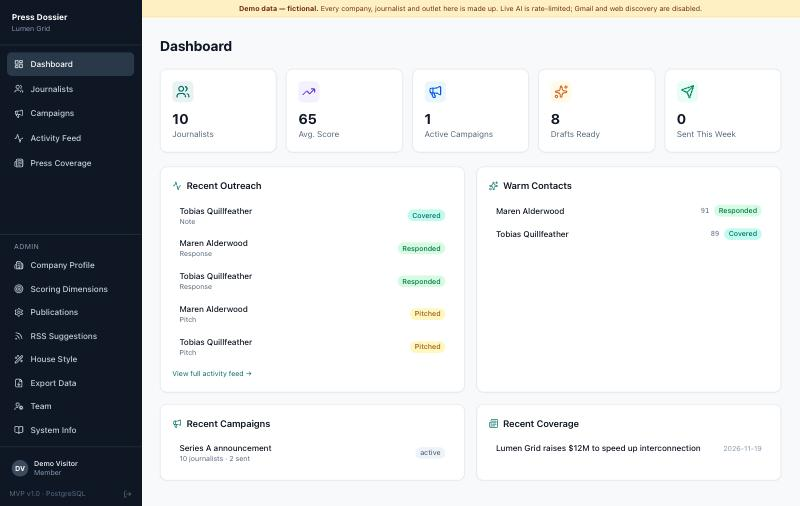
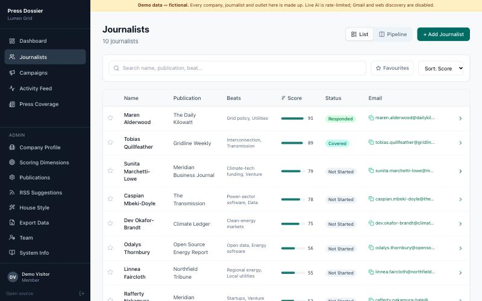
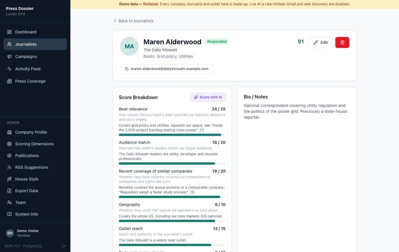
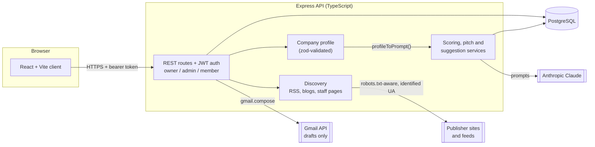
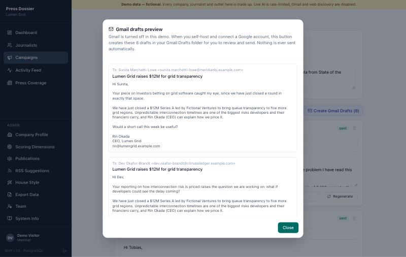

# Press Dossier

An open-source PR research tool. Give it your company profile, and it helps you find journalists who cover your space, builds a dossier on each one, scores how well they fit *your* company with a reason and the articles it cites, and drafts a personalized pitch you review and send yourself.

**Live demo:** [press-dossier.vercel.app](https://press-dossier.vercel.app) · fictional company and journalists, live AI runs are rate-limited. The API sleeps when idle, so the first load can take up to a minute.



## Why

Most pitches fail because they're sent to the wrong person with the wrong angle. Press Dossier keeps three things together in one place: who covers what (and what they have actually written), how well each journalist fits *your* company, and a draft pitch that uses your real story, news and spokespeople. AI scores come with a reason and, where there is one, the articles they cite; nothing is ever sent without a human doing it.

## What it does

- **Company profile as the single source of truth.** One profile (what you do, audience, regions, story angles, news, competitors, spokespeople, tone, signature) feeds every AI step. Set it up in a first-run wizard, in Settings, or from a `company.config.json` file with no UI at all.
- **Configurable fit scoring.** Define your own dimensions (defaults: beat relevance, audience match, similar-company coverage, geography, outlet reach, responsiveness) with weights. Claude scores each journalist per dimension, writes a one-line rationale, and can cite the journalist's recorded articles. Cited URLs are kept only if they are in that journalist's article list. (It sees article titles, not full text: treat a score as a lead to check.)
- **Dossiers.** Beats, bio, articles, outreach history and scores per journalist, with a pipeline and list view.
- **Pitch drafts.** Built from your profile plus the journalist's dossier: the best-fitting story angle, a relevant news item, the most relevant spokesperson, your tone and signature. Edit, regenerate with instructions, or write your own.
- **Gmail drafts, never sends.** Optionally create drafts in your own Gmail with the `gmail.compose` scope. Google lets that scope send too, but the app only ever creates drafts and has no code that sends. A person reviews and sends from Gmail.
- **Discovery** (self-hosted): RSS auto-discovery, blog/newsletter search (Feedly, Substack, Medium), staff-page scanning, RSS byline detection, feed health checks, AI publication suggestions, and OPML import. Every suggestion needs explicit accept/reject.
- **Campaigns, outreach log, press coverage, CSV export, team invites with owner/admin/member roles.**

| Journalist list | Dossier with rationale and evidence |
|---|---|
|  |  |

## Architecture



Details in [docs/architecture.md](docs/architecture.md). Why it is built this way, and what went wrong: [docs/design.md](docs/design.md).

## Self-host in 5 minutes

You need **Node 22+**, **PostgreSQL** (local, Neon, Supabase, Render, …) and an **Anthropic API key**.

```bash
git clone <this repo> press-dossier && cd press-dossier
npm install && npm install --prefix server && npm install --prefix client

cp server/.env.example server/.env      # then edit it (below)
cp client/.env.example client/.env      # only needed if the API isn't on localhost:3001

npm run migrate:up --prefix server      # create the tables
npm run dev                             # API on :3001, app on :5173
```

Edit `server/.env`:

| Variable | What |
|---|---|
| `DATABASE_URL` | Postgres connection string |
| `SESSION_SECRET` | Long random string (`openssl rand -hex 32`) |
| `ANTHROPIC_API_KEY` | From [console.anthropic.com](https://console.anthropic.com) |

Open <http://localhost:5173>. The first visit walks you through creating the owner account and describing your company. That's it.

**No UI?** Copy `company.config.example.json` to `company.config.json`, edit it, and set `ADMIN_EMAIL` / `ADMIN_PASSWORD` in `server/.env`. On first boot the app creates the owner and loads your profile and scoring dimensions. See [docs/configuration.md](docs/configuration.md).

### Gmail drafts (optional)

1. In [Google Cloud Console](https://console.cloud.google.com), create a project and enable the **Gmail API**.
2. **Google Auth Platform → Audience**: choose *External* and add your Gmail address under *Test users*. **Data Access**: add the scope `https://www.googleapis.com/auth/gmail.compose`.
3. **Clients → Create client → Web application**, with the authorized redirect URI `http://localhost:3001/auth/google/callback`.
4. Put the client ID and secret in `server/.env` (`GOOGLE_CLIENT_ID`, `GOOGLE_CLIENT_SECRET`, `GOOGLE_REDIRECT_URI`).
5. In the app: **House Style → Connect Gmail** (owner only), then **Create Gmail Drafts** on a campaign.

While the OAuth app is in *Testing* status, only listed test users can connect and Google expires refresh tokens after 7 days. Publishing the app requires Google's verification because `gmail.compose` is a restricted scope.

### Deploying

The reference setup is Vercel (client) + Render (API) + Neon (Postgres); see [docs/deployment.md](docs/deployment.md). Use a persistent Postgres for anything beyond a demo.

## Demo mode

`DEMO_MODE=true` seeds a fictional company ("Lumen Grid"), journalists and outlets; gives each visitor a private sandbox with one click; rate-limits live Claude calls per visitor and per day (falling back to saved results); replaces Gmail with a preview; and disables web discovery. It refuses to run against a database containing a real organization. See [docs/demo-mode.md](docs/demo-mode.md).



## Development

```bash
npm run lint          # server + client
npm run typecheck
npm test              # server tests (set DATABASE_URL to any local Postgres; they create and drop their own databases)
npm run build
```

CI runs lint, typecheck, tests against a Postgres service, the client build, and a gitleaks secret scan. Tests cover profile validation, prompt building, the score parser's handling of malformed model output, robots.txt rules, the demo limits and sandbox isolation, authentication, data integrity, malformed input across the API, and first-run setup.

## Limitations

- **One company per deployment.** There is no multi-company account switching.
- **Scores are AI estimates, not facts, and have not been evaluated against human judgments.** The model sees the profile, the beat, the bio and article *titles*, not article text; with no articles the model is told to estimate cautiously and say so. Review them.
- **Discovery is best-effort.** It depends on publishers exposing RSS and readable staff pages. Name extraction from staff pages is heuristic and noisy (expect job titles and non-editorial staff in the review queue). Substack/Feedly endpoints are unofficial and can change.
- **No contact enrichment.** Emails are entered by hand or copied from a publication's own page. The app never guesses addresses.
- **Gmail** in Testing status expires tokens weekly; the connection is per deployment, not per user, and the refresh token is stored unencrypted in your database.
- Login tokens live in the browser's `localStorage`; put the app behind HTTPS.
- The free-tier demo host sleeps when idle, so the first request can take up to a minute.

## Ethics

This tool is for professional outreach to journalists. It is built to keep a human in charge:

- **Nothing is sent automatically.** The app only creates drafts, and only when you ask.
- **Every pitch is reviewed by a person** before it leaves your Gmail.
- **Every discovery suggestion** (journalist or publication) requires an explicit accept.
- **Polite crawling.** Pages fetched from publisher sites (staff pages, homepages during feed discovery) are checked against `robots.txt` first, and requests identify themselves with a configurable User-Agent (`BOT_NAME`, `BOT_CONTACT_URL`) so site owners can reach you. Feeds are fetched with the same identification. There is no scraping behind logins.
- **Public, professional information only.** Don't store personal data you wouldn't want about yourself, and honor requests to be removed. Check the laws that apply to you (for example GDPR) before storing contact details of people in other jurisdictions.
- **Be honest in outreach.** AI drafts are a starting point. Don't let them claim things that aren't true.

## License

[MIT](LICENSE)
