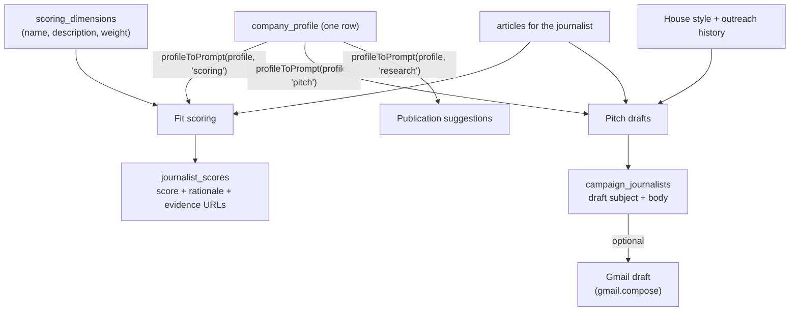

# Architecture

Press Dossier is a React single-page app talking to an Express API backed by PostgreSQL. Claude is called only from the server.

```
client/   React + TypeScript + Vite + Tailwind
server/   Express + TypeScript, PostgreSQL via `pg`, migrations via node-pg-migrate
```

## Server layout

| Path | Responsibility |
|---|---|
| `src/app.ts` | Builds the Express app: CORS, JSON, public routes, then everything behind `requireAuth` |
| `src/index.ts` | Runs `bootstrap()`, then listens (and schedules the sandbox sweep in demo mode) |
| `src/lib/companyProfile.ts` | The company profile: zod schema, load/save, and `profileToPrompt()` |
| `src/lib/bootstrap.ts` | Ensures the single org exists, seeds default scoring dimensions, applies `company.config.json`, creates the env admin |
| `src/lib/http.ts` | Honest User-Agent and the robots.txt check used for third-party page fetches |
| `src/lib/claude.ts` | The Claude model name (`ANTHROPIC_MODEL`) |
| `src/routes/*` | One router per resource. Every query is scoped by `org_id` taken from the JWT |
| `src/services/*` | Scoring, pitch drafts, publication suggestions, discovery (RSS, blogs, staff pages), health checks, Gmail |
| `src/demo/*` | Demo seed data, per-visitor sandboxes, the live-AI limiter |
| `migrations/` | Versioned schema changes (CommonJS) |

## One company per deployment

There is a single real `organizations` row, created on boot. Rows in every table still carry `org_id` (so queries are explicitly scoped and the schema stays simple to reason about), but the app never creates a second one. (In [demo mode](demo-mode.md) there is none: each visitor gets a temporary sandbox organization instead.) The first signup becomes the owner; everyone else joins by invite.

## The company profile drives every AI step



`profileToPrompt()` omits empty fields, so a half-filled profile never produces blank headings, and it includes different sections per purpose (for example competitors for scoring; spokespeople, news items, tone and signature for pitches).

### Fit scoring

`runAiScoring(orgId, journalistId)` is the single entry point (the "Score with AI" button and auto-score on accept both use it):

1. Load the profile, the scoring dimensions and the journalist's last 10 articles.
2. Build the prompt: profile + dimensions (id, name, description, max) + dossier + the only URLs the model may cite.
3. Parse the response with `parseScoringResponse()`: tolerates code fences, prose around the JSON, trailing commas and smart quotes; salvages `dimensionId`/`score` pairs from unrecoverable JSON; clamps each score to its dimension's weight; drops unknown or duplicate dimensions; and **removes any evidence URL that isn't one of the journalist's recorded articles**.
4. Upsert `journalist_scores` (score, rationale, evidence) and recompute the total.

### Pitch drafts

`generateCampaignDraft()` adds the campaign brief, the campaign type's house style, the journalist's articles and outreach history, and instructs the model to choose one angle or news item, name the best-matching spokesperson, match the tone, and end with the exact signature.

## Auth and roles

- Email + password (bcrypt), JWT (HS256, 7 days) sent as `Authorization: Bearer`.
- Roles: **member** works with journalists, campaigns, outreach and coverage. **admin** also manages publications, scoring dimensions, house style, the company profile, and discovery. **owner** also manages the team and the Gmail connection.
- The role is read from the database on every request, so removing or demoting someone takes effect at once.
- Signup is open only until the first account exists.

## Discovery and polite crawling

RSS auto-discovery, category-feed discovery and staff-page scanning fetch publisher HTML pages. They identify themselves with `BOT_USER_AGENT` (or `BOT_NAME` + `BOT_CONTACT_URL`) and skip pages that `robots.txt` disallows for the bot. Blog search uses Feedly, Substack and Medium endpoints. Every discovered journalist or publication lands in a review queue; nothing is added without an explicit accept.

## Data model (summary)

`organizations` · `users` · `invites` · `company_profile` · `scoring_dimensions` · `publications` · `publication_feeds` · `publication_suggestions` · `journalists` · `journalist_scores` · `journalist_suggestions` · `articles` · `campaigns` · `campaign_journalists` · `campaign_type_styles` · `outreach_logs` · `coverage` · `gmail_connections`

A journalist's outreach status is derived from their latest `outreach_logs` row rather than stored, so it can never drift out of sync.

## Security notes

- Secrets live in environment variables only. `.env`, `*.db` and `company.config.json` are git-ignored; CI runs gitleaks.
- The Gmail refresh token is stored **unencrypted** in `gmail_connections`. Use a database with encryption at rest and restrict access to it.
- The browser keeps the JWT in `localStorage`; serve the app over HTTPS.
- Gmail access uses `gmail.compose`, Google's narrowest scope for drafts. It would also permit sending; the app only creates drafts and has no code path that sends.
